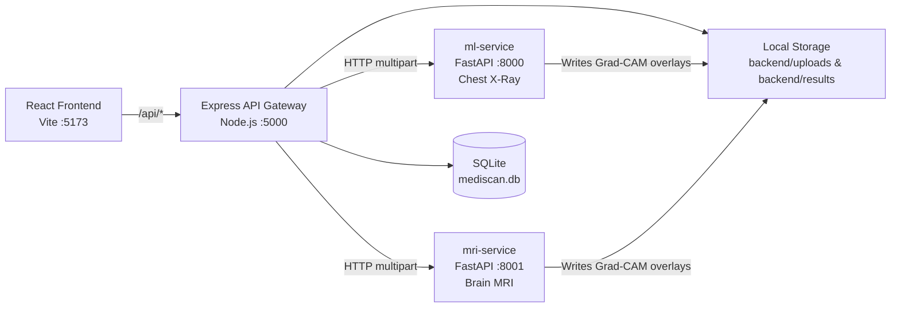
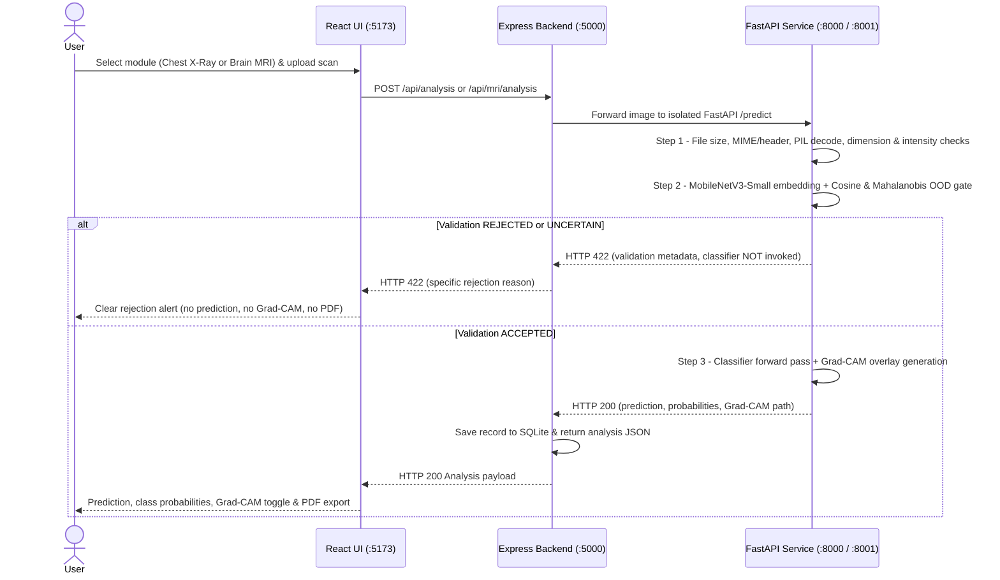

# MediScan AI

**Dual-Modality Medical Imaging Diagnostic Research Platform (Chest X-Ray Pneumonia & Brain MRI Tumour Analysis)**

> [!WARNING]
> **Research Prototype Only — Not a Clinical Medical Device.**
> All validation gates, model predictions, confidence scores, and Grad-CAM heatmaps generated by MediScan AI are intended strictly for machine learning research, educational demonstration, and engineering evaluation. Neither the input validators nor the diagnostic classifiers are clinically validated medical decisions and must never be used for patient diagnosis, triage, or treatment.

---

## Table of Contents

1. [Overview](#overview)
2. [System Architecture](#system-architecture)
3. [Technology Stack](#technology-stack)
4. [Repository Structure](#repository-structure)
5. [Input Validation & OOD Screening](#input-validation--ood-screening)
6. [Model Architectures & Evaluation Results](#model-architectures--evaluation-results)
7. [API Reference](#api-reference)
8. [Local Setup & Running](#local-setup--running)
9. [Environment Variables](#environment-variables)
10. [Known Limitations](#known-limitations)
11. [Security & Privacy Notes](#security--privacy-notes)
12. [Upstream Credits & Licenses](#upstream-credits--licenses)

---

## Overview

MediScan AI provides a unified React clinical research workstation backed by a Node.js/Express gateway and two **isolated Python FastAPI + PyTorch ML microservices**:

- **Chest X-Ray Pneumonia Module (`ml-service`, port `8000`)**: Binary classification (`NORMAL` vs. `PNEUMONIA`) using `DenseNet121Pneumonia` (`best_model_pytorch.pth`), protected by a calibrated Chest X-Ray validation & out-of-distribution (OOD) gate (`validate_chest_xray`).
- **Brain MRI Tumour Module (`mri-service`, port `8001`)**: 4-class tumour classification (`glioma`, `meningioma`, `notumor`, `pituitary`) using `ResNet-18` (`tumor_model.pth`), protected by an independent Brain MRI validation & OOD gate (`validate_brain_mri`).

Every uploaded scan passes through format, decoding, and domain-specific OOD validation **before** diagnostic inference or Grad-CAM generation is allowed to run (fail-closed gating returning HTTP `422` for rejected images). Accepted scans generate Grad-CAM overlays, persist metadata locally in SQLite (`better-sqlite3`), and export downloadable PDF reports (`pdfkit`).

---

## System Architecture

### Service Topology



### Fail-Closed Request Flow



---

## Technology Stack

| Layer | Technologies & Verified Manifest Versions |
| :--- | :--- |
| **Frontend (`frontend/`)** | React `^18.3.1`, React DOM `^18.3.1`, React Router DOM `^6.28.0`, Vite `^6.0.1`, `@vitejs/plugin-react` `^4.3.4` |
| **Backend Gateway (`backend/`)** | Node.js (ESM), Express `^4.21.1`, Multer `^1.4.5-lts.1`, Axios `^1.7.7`, Form-Data `^4.0.1`, `better-sqlite3` `^11.5.0`, PDFKit `^0.15.1`, CORS `^2.8.5`, `dotenv` `^16.4.5`, UUID `^11.0.3` |
| **Chest X-Ray Service (`ml-service/`)** | FastAPI `0.115.5`, Uvicorn `0.32.1`, `python-multipart` `0.0.12`, `python-dotenv` `1.0.1`, PyTorch + Torchvision (`DenseNet121Pneumonia`, MobileNetV3-Small validator), Pillow, OpenCV, NumPy, PyYAML |
| **Brain MRI Service (`mri-service/`)** | FastAPI `>=0.115.0`, Uvicorn `>=0.32.0`, `python-multipart` `>=0.12`, `python-dotenv` `>=1.0.1`, PyTorch + Torchvision (`ResNet-18`, MobileNetV3-Small validator), NumPy, Pillow, OpenCV/SciPy |
| **Training & Research Modules** | `Chest-Xray-Pneumonia/` (PyTorch & TensorFlow/Keras training & Grad-CAM evaluation scripts), `Brain-MRI-Tumour/` (ResNet-18 training, leakage audit, patient-disjoint CV, calibration, Grad-CAM) |

---

## Repository Structure

```text
MEDISCAN AI/
├── frontend/                   # React + Vite clinical UI (:5173)
├── backend/                    # Node.js Express gateway, SQLite store, PDF generator (:5000)
│   ├── src/
│   │   ├── controllers/
│   │   ├── db/
│   │   ├── middleware/
│   │   ├── routes/
│   │   ├── services/
│   │   └── utils/
│   ├── uploads/                # Runtime uploads (git-ignored; keeps .gitkeep)
│   └── results/                # Runtime Grad-CAM overlays (git-ignored; keeps .gitkeep)
├── ml-service/                 # Isolated Chest X-Ray FastAPI inference & validator (:8000)
├── mri-service/                # Isolated Brain MRI FastAPI inference, validator & artifacts (:8001)
├── Chest-Xray-Pneumonia/       # DenseNet-121 training/evaluation code & best_model_pytorch.pth
├── Brain-MRI-Tumour/           # ResNet-18 training/audit code & checkpoints/tumor_model.pth
├── image-validation-dataset/   # Small 12-probe benchmark & split skeleton for validator testing
├── documentation/              # Detailed Chest X-Ray setup & execution guide
├── start_all.bat               # Windows one-click launcher for all 4 services
├── stop_all.bat                # Windows service shutdown helper
└── run.bat                     # Alternate Windows launcher
```

---

## Input Validation & OOD Screening

Neither ML service uses the diagnostic classifier's softmax output alone to accept or reject uploads. Each service enforces an independent validation gate:

### 1. Chest X-Ray Gate (`ml-service/validator.py`)

- **Pre-checks**: File type (`JPG`/`JPEG`/`PNG`), size limits, safe PIL decode, aspect ratio/resolution, grayscale/saturation sanity.
- **Feature-Space OOD Screening**: Extracts normalized `MobileNetV3-Small` embeddings and scores candidate scans against a calibrated Chest X-Ray reference distribution (`ml-service/cxr_reference_distribution.npz`) combining cosine similarity, Mahalanobis distance, and radiographic heuristics.
- **Fail-Closed Policy**: Non-chest X-rays (hand, wrist, foot, knee, dental), MRIs, CT scans, photographs, documents/screenshots, and corrupted files return `REJECTED` or `UNCERTAIN` with HTTP `422` before the pneumonia model runs.
- **Observed Probe Benchmark (`benchmark_pipeline.py`)**: Verified on the included 12-probe test suite (`image-validation-dataset/test/`): `2/2` Chest X-Rays accepted (`01_normal_chest_xray.jpeg`, `02_pneumonia_chest_xray.jpeg`) and `10/10` non-chest probes rejected (`0.00%` false acceptance rate on that 12-image suite).

### 2. Brain MRI Gate (`mri-service/validator.py`)

- **Pre-checks**: File type (`image/jpeg`, `image/png`), image decoding, resolution/aspect validation, and intensity checks.
- **Calibrated OOD Model**: Uses `MobileNetV3-Small` feature embeddings paired with centroid cosine similarity, shrunk Mahalanobis distance, and calibrated logistic regression (`mri-service/mri_validator_artifacts.npz`), calibrated at `cos_accept = 0.68`, `maha_accept = 46.1`, `prob_accept = 0.8988` using patient-disjoint Brain MRI validation scans vs. Chest X-Rays (`mri-service/mri_validator_report.json`).
- **Observed Evaluation (`mri-service/mri_validator_report.json`)**:
  - **Testing Brain MRI Sensitivity**: **`99.54%` (`1,305 / 1,311`)** — `glioma` `298/300` (`99.33%`), `meningioma` `303/306` (`99.02%`), `notumor` `404/405` (`99.75%`), `pituitary` `300/300` (`100.00%`).
  - **Negative / Non-MRI Specificity**: **`100.00%` (`637 / 637`)** — `624/624` Testing Chest X-Rays rejected, `9/9` non-chest benchmark probes rejected, `4/4` synthetic noise/blank/text probes rejected (`0.00%` FAR on the tested negative suite).

---

## Model Architectures & Evaluation Results

### Chest X-Ray Pneumonia (`DenseNet121Pneumonia`)

- **Checkpoint**: `Chest-Xray-Pneumonia/outputs/models/best_model_pytorch.pth` (binary classification: `NORMAL`, `PNEUMONIA`, with Grad-CAM target layer `features.denseblock4.denselayer16`).
- **Evaluation Metrics & Discrepancy Note**:
  - On the **624-image Chest X-Ray test split** (`234` Normal, `390` Pneumonia), the local TensorFlow/Keras evaluation artifact (`Chest-Xray-Pneumonia/outputs/reports/metrics.json`) records: Accuracy **`84.62%`**, AUC-ROC **`0.9429`**, Recall **`99.74%`** (`389/390`), Specificity **`59.40%`** (`139/234`), Precision **`80.37%`**, F1 **`0.8902`** (`TN=139, FP=95, FN=1, TP=389`).
  - Both the local Keras evaluation report and project summary metrics highlight **high sensitivity on Pneumonia (`>=99.7%`) paired with elevated false positives on Normal X-rays (~`59%` specificity)**.
  - *Artifact note*: `ml-service` runs inference using the PyTorch checkpoint (`best_model_pytorch.pth`), whereas `outputs/reports/metrics.json` documents the TensorFlow/Keras evaluation artifact; a matching standalone PyTorch-only JSON report on the 624 test split is not separately stored in `outputs/reports/`.

### Brain MRI Tumour (`ResNet-18`)

- **Checkpoint**: `Brain-MRI-Tumour/checkpoints/tumor_model.pth` (`4` classes: `glioma`, `meningioma`, `notumor`, `pituitary`, Grad-CAM over `layer4`).
- **Training & Evaluation Context**:
  - **Local Training Log (`Brain-MRI-Tumour/outputs/figures/history.json`)**: Trained for `19` epochs on the Mendeley Brain Tumor dataset (`5,712` Training / `1,311` Testing; `7,023` images total), achieving best validation accuracy **`99.04%`** (`0.990376`) and best validation loss **`0.0331`** at epoch `14`.
  - **Held-Out Test Summary vs. Leakage Audit**: While evaluations on the standard 7,023-image released split exceed **`99%`** accuracy (matching upstream `Brain-MRI-Tumour/README.md` reporting `99.22%` on the standard released split), the upstream leakage audit (`Brain-MRI-Tumour/README.md`) demonstrates significant patient-level slice overlap between `Training/` and `Testing/` in the public dataset — under strict **patient-disjoint 5-fold cross-validation (`6,292` images)**, ResNet-18 achieves **`95.19%`** accuracy (`93.68%` tumor-only).

---

## API Reference

All client requests route through the Node.js Express gateway (`http://localhost:5000/api`):

| Method | Endpoint | Purpose |
| :--- | :--- | :--- |
| `GET` | `/api/health` | Aggregate health check for Express + `ml-service` (`:8000`) + `mri-service` (`:8001`) |
| `POST` | `/api/validate` | Chest X-Ray validation pre-check (forwards to `:8000`) |
| `POST` | `/api/analysis` | Full Chest X-Ray validation + Pneumonia classification + Grad-CAM (`:8000`) |
| `POST` | `/api/mri/validate` | Brain MRI validation pre-check (forwards to `:8001`) |
| `POST` | `/api/mri/analysis` | Full Brain MRI validation + 4-class tumour classification + Grad-CAM (`:8001`) |
| `GET` | `/api/analysis` | List persisted analyses from SQLite (filterable by modality/type) |
| `GET` | `/api/analysis/:id` | Fetch a single saved analysis record |
| `GET` | `/api/analysis/:id/report` | Generate and stream downloadable PDF report (`pdfkit`) |
| `DELETE` | `/api/analysis/:id` | Delete an analysis record and its generated files |
| `GET` | `/api/results/:filename` | Serve Grad-CAM overlay / original assets (with path-traversal protection) |

---

## Local Setup & Running

### Prerequisites

- **Node.js** (v18+ / v20+ LTS) & **npm**
- **Python 3.11+** (separate virtual environments recommended for `Chest-Xray-Pneumonia/venv` and `Brain-MRI-Tumour/venv`, with PyTorch + CUDA or CPU)
- Pretrained checkpoints already included in the repository:
  - `Chest-Xray-Pneumonia/outputs/models/best_model_pytorch.pth` (`80.49 MB`)
  - `Brain-MRI-Tumour/checkpoints/tumor_model.pth` (`42.72 MB`)
  - Validator artifacts: `ml-service/cxr_reference_distribution.npz` and `mri-service/mri_validator_artifacts.npz`
  - *Note on MobileNetV3-Small weights*: On first run, Torchvision loads `mobilenet_v3_small` from `%USERPROFILE%/.cache/torch/hub/checkpoints/` (or downloads ~`10 MB` automatically if not cached).

### 1. Environment Setup

Create `.env` files from the provided `.env.example` templates if missing:

```powershell
copy backend\.env.example backend\.env
copy frontend\.env.example frontend\.env
copy ml-service\.env.example ml-service\.env
copy mri-service\.env.example mri-service\.env
```

Install Node dependencies:

```powershell
npm --prefix backend install
npm --prefix frontend install
```

Set up Python environments (one for Chest X-Ray, one for Brain MRI):

```powershell
# Chest X-Ray environment
cd Chest-Xray-Pneumonia
python -m venv venv
.\venv\Scripts\pip install -r requirements.txt
.\venv\Scripts\pip install -r ..\ml-service\requirements.txt
cd ..

# Brain MRI environment
cd Brain-MRI-Tumour
python -m venv venv
.\venv\Scripts\pip install -r requirements.txt
.\venv\Scripts\pip install -r ..\mri-service\requirements.txt
cd ..
```

*(Optional — only needed if retraining or re-calibrating validators from scratch)*: Download the Kaggle Chest X-Ray Pneumonia dataset to `Chest-Xray-Pneumonia/data/raw/` and Mendeley Brain Tumor MRI dataset (`DOI: 10.17632/w4sw3s9f59.1`) to `datasets/brain-mri/`. Raw datasets are excluded from Git via `.gitignore`.

### 2. Running All Services

#### Windows One-Click Launcher

Double-click or run from the repository root:

```cmd
start_all.bat
```

This starts all 4 services in separate console windows and opens `http://localhost:5173`. Run `stop_all.bat` to terminate all processes on ports `8000`, `8001`, `5000`, and `5173`.

#### Manual Startup (4 Terminals)

```powershell
# Terminal 1 — Chest X-Ray ML Service (:8000)
cd ml-service
..\Chest-Xray-Pneumonia\venv\Scripts\python.exe -m uvicorn app:app --host 127.0.0.1 --port 8000

# Terminal 2 — Brain MRI ML Service (:8001)
cd mri-service
..\Brain-MRI-Tumour\venv\Scripts\python.exe -m uvicorn app:app --host 127.0.0.1 --port 8001

# Terminal 3 — Express Backend (:5000)
cd backend
npm run dev

# Terminal 4 — React Frontend (:5173)
cd frontend
npm run dev
```

---

## Environment Variables

| File | Variable | Default Example |
| :--- | :--- | :--- |
| `backend/.env` | `PORT` | `5000` |
| `backend/.env` | `FRONTEND_URL` | `http://localhost:5173` |
| `backend/.env` | `ML_SERVICE_URL` | `http://127.0.0.1:8000` |
| `backend/.env` | `MRI_SERVICE_URL` | `http://127.0.0.1:8001` |
| `backend/.env` | `UPLOADS_DIR` / `RESULTS_DIR` / `DB_PATH` | `./uploads`, `./results`, `./mediscan.db` |
| `ml-service/.env` | `CHECKPOINT_PATH` / `RESULTS_DIR` | `../Chest-Xray-Pneumonia/outputs/models/best_model_pytorch.pth`, `../backend/results` |
| `mri-service/.env` | `CHECKPOINT_PATH` / `RESULTS_DIR` | `../Brain-MRI-Tumour/checkpoints/tumor_model.pth`, `../backend/results` |
| `frontend/.env` | `VITE_API_BASE_URL` | `/api` |

---

## Known Limitations

- **OOD Validator Scope**: The Brain MRI validator (`mri-service/validator.py`) was calibrated against Brain MRI scans (`Training/` subset) and Chest X-Rays rather than external labeled body-part MRI datasets (e.g., knee or spine MRI). Out-of-domain body-part MRIs should still be evaluated cautiously.
- **Chest X-Ray Normal Specificity**: On the benchmark 624-image Chest X-Ray test set, sensitivity for Pneumonia is very high (~`99.7%`–`100%`), while Normal X-ray specificity is ~`59%` (`FP ≈ 95–96` out of `234`).
- **Dataset Leakage on Brain MRI Standard Split**: As audited by `Brain-MRI-Tumour`, the public 7,023-image Brain MRI split shares patients across `Training/` and `Testing/`, inflating single-split test accuracy (~`99%`) relative to patient-disjoint 5-fold CV (`95.19%`).
- **Grad-CAM Interpretability**: Heatmaps highlight convolutional spatial activations (`DenseNet-121` final dense layer / `ResNet-18` `layer4`) and represent rough spatial saliency rather than calibrated pathology segmentation.

---

## Security & Privacy Notes

- **No PHI / Cloud Upload**: All uploads, SQLite records (`backend/mediscan.db`), and generated Grad-CAM overlays stay local and are excluded from version control via `.gitignore`.
- **Fail-Closed Validation**: If either Python validator fails to load or rejects an image, diagnostic inference returns HTTP `422` or `503` without executing the classifier.
- **Safe File Serving**: `/api/results/:filename` validates filenames and blocks directory traversal (`..`, `/`, `\`).

---

## Upstream Credits & Licenses

- **Chest X-Ray Module**: Adapted from [SWAPI03/Chest_Xray_Disease_Detection](https://github.com/SWAPI03/Chest_Xray_Disease_Detection) (see `Chest-Xray-Pneumonia/README.md`).
- **Brain MRI Module & Leakage Audit**: Built upon [imjbassi/Brain-Tumor-MRI-Classification](https://github.com/imjbassi/Brain-Tumor-MRI-Classification) (*Brain Tumor MRI Benchmark Audit*, MIT License, see `Brain-MRI-Tumour/LICENSE` and `Brain-MRI-Tumour/CITATION.cff`).
- **Brain MRI Dataset Citation**: Ayesha Ghaffar (2024), *Brain Tumor Data*, Mendeley Data, V1, DOI: `10.17632/w4sw3s9f59.1` (CC BY 4.0).
